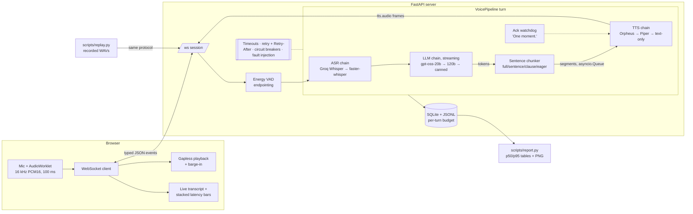
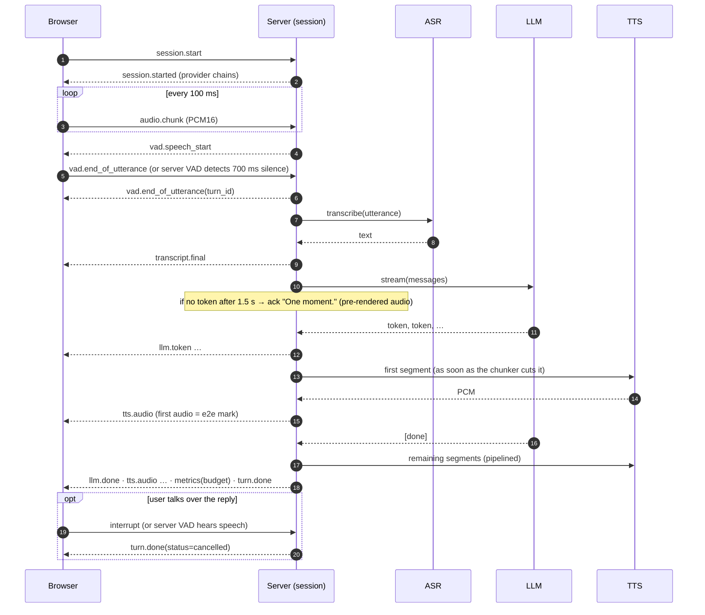
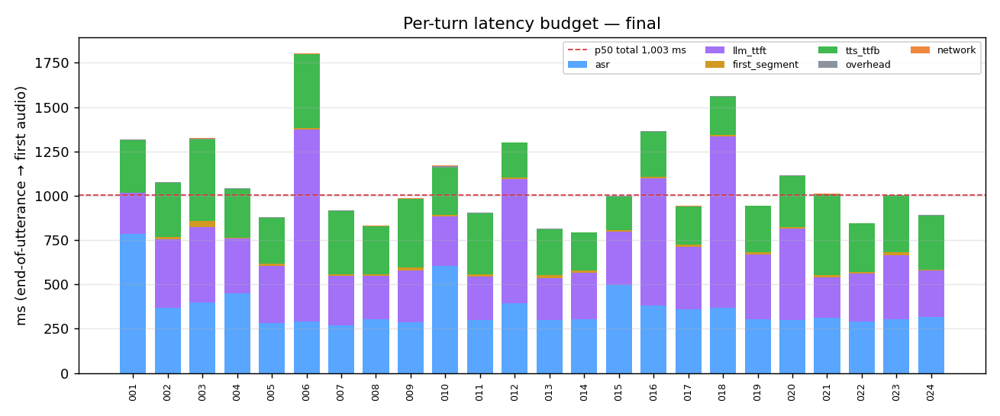
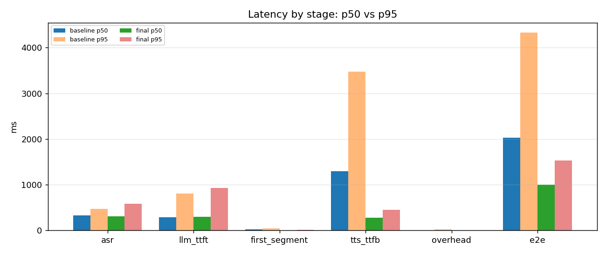

# SkyMate: a real-time voice copilot for drone operations

**Browser mic → WebSocket → ASR → streaming LLM → streaming TTS → speaker.** It records a latency budget for every turn and keeps working when a provider fails.

   

> Every number in this README was measured in this repo's sandbox (2 vCPU, 7 GB RAM, no GPU, no microphone), against the live Groq API. Raw per-turn data is in [`reports/`](reports/).

---

## 1. Problem

A voice assistant only feels natural if it starts speaking about a second after you stop. To get there you have to handle three things that batch ML systems never deal with:

1. **Streaming.** Audio arrives in 100 ms chunks. The LLM emits tokens. TTS must start on the first sentence, not the whole reply.
2. **A latency budget.** "It feels slow" is not actionable. You need to know how many milliseconds go to ASR, LLM time-to-first-token, TTS time-to-first-byte and overhead, on every turn.
3. **Failure.** ASR goes down, the LLM stalls, TTS has a quota problem. The system has to degrade *audibly and honestly* ("One moment.") instead of hanging in silence.

SkyMate is a drone-ops copilot (pre-flight checks, battery and wind limits, failsafes, DGCA Digital Sky basics). It answers in short spoken sentences and is built to handle all three.

## 2. Architecture





**Code map**

| path | what |
|---|---|
| `app/protocol.py` | Pydantic discriminated unions for every client and server event |
| `app/pipeline.py` | One turn: ASR → LLM producer → chunker → queue → TTS consumer, plus the ack watchdog, fallbacks and budget |
| `app/resilience.py` | `ProviderError` taxonomy, full-jitter retry that honours `Retry-After`, 3-state `CircuitBreaker` |
| `app/providers/` | `ASRProvider` / `LLMProvider` / `TTSProvider` protocols. Groq, faster-whisper, Piper, canned LLM, Deepgram/ElevenLabs/Cartesia adapters, mocks, fault wrappers |
| `app/chunker.py` | Incremental sentence/clause chunker (handles abbreviations, decimals, markdown stripping) |
| `app/metrics.py` | Stopwatch milestones → budget decomposition → SQLite + JSONL |
| `app/server.py` | FastAPI app, WebSocket sessions, server VAD, barge-in, `/health`, `/api/metrics` |
| `web/` | Dependency-free client: AudioWorklet capture, playback queue, live transcript, stacked latency bars |
| `scripts/` | `gen_utterances`, `replay`, `chunk_ablation.sh`, `report`, `fault_demo`, `ws_client_test` |

## 3. Event protocol

Every frame is JSON with a `type` discriminator, and unknown or malformed frames are rejected. Audio is base64 PCM16 LE mono: 16 kHz upstream, with the sample rate stated on every `tts.audio` frame.

| direction | `type` | key fields | purpose |
|---|---|---|---|
| C→S | `session.start` | `label`, `sample_rate`, `server_vad`, `chunk_mode`, `persona`, `faults`* | open a session (*faults honoured only with `ALLOW_CLIENT_FAULTS=true`) |
| C→S | `audio.chunk` | `data`, `seq` | 100 ms of mic audio |
| C→S | `vad.end_of_utterance` | `client_ts` | client endpointing (push-to-talk release, replay) |
| C→S | `text.input` | `text` | typed query (skips ASR) |
| C→S | `interrupt` | `reason` | barge-in: cancel the in-flight turn |
| C→S | `metrics.client` | `turn_id`, `client_e2e_ms` | client-measured EoU → first audio |
| C→S | `session.end` | | close the session |
| S→C | `session.started` | `session_id`, `providers`, `faults` | ack plus active provider chains |
| S→C | `vad.speech_start` | `ts` | server VAD heard speech (client stops playback) |
| S→C | `vad.end_of_utterance` | `turn_id`, `source` (client/server_vad/max_length), `audio_ms` | turn begins |
| S→C | `transcript.partial` | `text` | interim transcript (opt-in, `ASR_PARTIALS=true`) |
| S→C | `transcript.final` | `turn_id`, `text`, `provider` | final transcript |
| S→C | `llm.token` / `llm.done` | `token` / `text`, `provider` | streamed reply |
| S→C | `tts.audio` | `data`, `sample_rate`, `seq`, `sentence`, `provider` | ≤250 ms audio frames |
| S→C | `ack` | `text`, `reason` (llm_slow / asr_unavailable) | degradation notice, also spoken |
| S→C | `error` | `code`, `stage`, `message`, `recoverable` | a provider failed (and what happened next) |
| S→C | `metrics` | `budget`, `providers`, `degraded` | per-turn latency budget |
| S→C | `turn.done` | `status` (ok/degraded/cancelled/failed), `text_only` | end of turn |

## 4. Quickstart

```bash
python -m venv .venv && . .venv/bin/activate
make install                 # pinned runtime + dev deps
make models                  # Piper fallback voice (~60 MB); faster-whisper tiny.en downloads on first use
cp .env.example .env         # set GROQ_API_KEY
make run                     # http://localhost:8000 → Connect → Start mic (or type)
```

Docker (the offline fallbacks are baked into the image): `docker compose up --build`.

```bash
make test                    # 45 unit/integration tests, mocked providers, no network
make utterances              # synthesize the 24-query regression set (Piper)
make replay LABEL=mine       # replay it through a running server over the real protocol
make ws-test                 # 7-check live WebSocket client test
make faults                  # 9 fault-injection scenarios against real providers
make report                  # p50/p95 tables + PNG charts → reports/LATENCY_REPORT.md
```

To swap providers, change config only, for example `ASR_CHAIN=deepgram,faster_whisper`, `LLM_CHAIN=groq,groq:openai/gpt-oss-120b,degraded` or `TTS_CHAIN=elevenlabs,piper`. `GROQ_BASE_URL` can point at any OpenAI-compatible server.

## 5. Measured latency budget

**Setup:** 24 synthesized drone-ops questions replayed over the WebSocket protocol (`scripts/replay.py`, explicit end-of-utterance). Providers: Groq `whisper-large-v3-turbo` → Groq `openai/gpt-oss-20b` (reasoning_effort=low) → Piper `en_US-lessac-low` on CPU. **`e2e` = server-side end-of-utterance → first `tts.audio` frame sent. `client e2e` adds the WebSocket hop as measured by the replay client.**

### Final configuration (`final`: eager chunking, 24/24 turns ok, ASR WER 1.2%)

| stage | p50 (ms) | p95 (ms) | share of p50 e2e |
|---|---:|---:|---:|
| ASR (EoU → final transcript, incl. upload) | 310 | 589 | 31% |
| LLM time-to-first-token | 305 | 927 | 30% |
| first token → first speakable segment | 10 | 16 | 1% |
| TTS time-to-first-byte | 275 | 448 | 27% |
| overhead (queueing, encoding, event loop) | 2 | 6 | <1% |
| **e2e: time to first audio (server)** | **1,002** | **1,531** | |
| network + client (localhost WS) | 2 | 5 | |
| **client e2e** | **1,003** | **1,532** | |
| LLM total | 386 | 986 | |

> "Our time to first audio is about 1.0 s at p50. ASR and LLM TTFT take roughly 300 ms each, Piper's first audio about 275 ms, and the orchestration overhead is 2 ms."



### First run (`baseline`): what the budget revealed

The first 24-turn run used `clause` chunking while other jobs were saturating the shared 2-vCPU box (1-minute load average ≈ 9.3, vs ≈ 4.1 during `final`):

| | e2e p50 | e2e p95 | TTS TTFB p50 | TTS share of e2e |
|---|---:|---:|---:|---:|
| `baseline` (clause, load ≈ 9.3) | 2,026 | 4,329 | 1,293 | **64%** |
| `final` (eager, load ≈ 4.1) | 1,002 | 1,531 | 275 | 27% |

The budget pointed straight at **CPU-bound TTS**, not the network or the LLM. Most of the baseline-to-final gap comes from CPU contention (which this repo does not control), so I isolated the effect of the code change with an interleaved A/B:



### Chunking A/B (interleaved: each utterance runs in all 4 modes back-to-back, so load drift hits every mode equally)

| mode | e2e p50 | e2e p95 | TTS TTFB p50 | TTS TTFB p95 | median paired saving vs `full` |
|---|---:|---:|---:|---:|---:|
| `full` (no streaming to TTS) | 1,121 | 2,060 | 560 | 1,490 | – |
| `sentence` | 916 | 1,906 | 371 | 1,135 | 60 ms (6/12 wins) |
| `clause` | 1,030 | 1,642 | 472 | 940 | 65 ms (6/12) |
| `eager` (≤7-word first segment) | 1,022 | 1,912 | 361 | 1,259 | **141 ms (7/12)** |

What this showed: with Groq, gpt-oss produces its visible answer in a burst. The time from first token to first segment is about 10 ms, so "wait for a sentence" costs almost nothing. The lever is how much text the first TTS call has to synthesize. Shortening the first segment cut TTS TTFB p50 from 560 → 361 ms. With n=12 the e2e gains are modest and noisy (about half the pairs win), and I report them that way. `eager` is the default; the full tables are in [`reports/LATENCY_REPORT.md`](reports/LATENCY_REPORT.md).

## 6. Resilience matrix

Measured with `scripts/fault_demo.py`: 9 scenarios, 26 turns, live Groq plus local fallbacks, and a fresh pipeline and breakers per scenario. Faults use the same `FaultConfig` the server reads from `FAULT_*` env vars. Details are in [`reports/RESILIENCE_REPORT.md`](reports/RESILIENCE_REPORT.md).

| failure | detection | response | measured result |
|---|---|---|---|
| **ASR down** (Groq Whisper 503) | `ProviderError(retryable)` | 2 retries with jittered backoff → faster-whisper `tiny.en` (local) → breaker opens after 3 failed turns | 4/4 turns answered; ASR stage 2.0–3.0 s on the contended CPU; on turn 4 the breaker was open, so Groq wasn't called at all. Fallback WER 6% (1 of 4 transcripts had errors) |
| **All ASR down** | chain exhausted | speak a pre-rendered apology, `ack(reason=asr_unavailable)` | apology audio **379 ms** after EoU, status `failed`, no hang |
| **LLM slow** (+2.5 s TTFT) | ack watchdog (1.5 s) | speak "One moment.", then the real answer | ack audio p50 **1.83 s**, answer at 3.7–4.5 s |
| **LLM hangs** | TTFT timeout 4 s (timeouts are not retried) | fall over to the canned safety reply | ack at ~1.8 s, canned answer audio at 5.0–5.2 s, never silent |
| **LLM hangs → secondary model** | same | `gpt-oss-120b` | turn 1: 120b answered (TTFT 4.39 s incl. the 4 s timeout). Turn 2: 120b returned **real 429s** (shared RPM quota) → canned reply |
| **Orpheus TTS** (real, no injected fault) | HTTP 400 `model_terms_required` = permanent | breaker opens on the first call → Piper | turn 1 paid one failed call; turns 2–3 skipped Orpheus; all 3 spoken |
| **All TTS down** | chain exhausted on 2 consecutive segments | text-only reply (`turn.done.text_only=true`), cached ack still plays | 2/2 turns delivered as text, no hang |
| **30% random transient faults** on every primary | retryable errors | retries absorb them | **8/8 turns produced audio** (6 ok). The 2 degraded turns were a *real* Groq TTFT stall (>4 s → canned) and a slow 1.9 s TTFT (→ ack) |
| **User talks over reply** | `interrupt` / server VAD speech start | cancel LLM and TTS tasks, persist metrics as `cancelled` | interrupt → `turn.done(cancelled)` in **105 ms** (ws_client_test) |
| **Malformed client event** | Pydantic validation | `error(bad_event)`, session stays open | verified in ws_client_test |

**Live WebSocket client test** (`scripts/ws_client_test.py`, real providers): **7/7 checks passed.** The checks: health, session handshake, text-turn event contract and ordering (client TTFA 667 ms), bad-event isolation, barge-in, server-VAD-endpointed audio turn (WER 0), and client fault override → local ASR fallback.

## 7. Design decisions

- **Typed JSON events with base64 audio** instead of raw binary frames. It is debuggable in any WS inspector and validated on both sides. The cost is about 33% bandwidth overhead on audio, which is fine at 32 kB/s upstream (binary frames are future work).
- **Batch Whisper plus VAD endpointing** instead of streaming ASR. Groq's Whisper is fast enough (p50 310 ms including upload) that a streaming ASR's added complexity isn't worth it here. Partials are available as opt-in because they cost one ASR call per interval against rate limits.
- **Producer/consumer per turn.** The LLM task feeds an `asyncio.Queue` of segments and the TTS task drains it, so synthesis of sentence *n* overlaps generation of sentence *n+1*.
- **Timeouts are not retried. Only fast transient errors are,** and only within budget. A timeout has already spent the stage's budget, so the pipeline fails over immediately. A 429 waits for the server's `Retry-After` hint, or skips to the next provider if the hint is longer than `RETRY_MAX_DELAY_S`.
- **LLM retries happen only before the first token.** After audio has started, a mid-stream failure keeps what was said and marks the turn `llm_truncated`, rather than restarting and repeating itself.
- **Permanent errors (401/403/400, terms not accepted) open the breaker immediately,** so no turn pays a doomed round-trip. Breakers are process-wide and keyed by provider, as they would be in production.
- **Never silent.** The ack watchdog speaks "One moment." if no token arrives in 1.5 s. Fixed phrases are pre-rendered at boot, so they play even when TTS is down. If every TTS fails, the reply is still delivered as text.
- **Measure from end-of-utterance** with monotonic milestones. The budget's components sum to e2e and the remainder is reported as `overhead`. Metrics are persisted even for cancelled turns.
- **Local fallbacks are warmed at boot.** Piper's first ONNX inference is about 10× slower than steady state, so the server reports `status: warming` until it is ready.

## 8. What went wrong and how I fixed it

1. **Orpheus TTS needs org-level terms acceptance.** Groq returned `400 model_terms_required`. This can't be fixed from code, so I classified it as a *permanent* error: the breaker opens on the first call and Piper takes over. Every TTS number above is Piper on CPU. The Orpheus adapter (streaming WAV parser) is implemented but **could not be verified**.
2. **Double endpointing produced a phantom turn.** In replay, the server VAD endpointed on trailing silence, and then the client's explicit EoU turned the remaining 200 ms of silence into a new turn. Whisper hallucinated *"Thank you."* on it, and the real turn was cancelled as superseded. Fix: silent buffers are dropped, and sessions can set `server_vad=false`.
3. **One bad event killed the session.** A `metrics.client` write hit a missing SQLite table, the exception escaped the socket loop, and the in-flight turn was cancelled. Fix: per-event error isolation, schema ensured per connection, and client metrics that arrive before the turn is persisted are buffered.
4. **My first A/B was confounded.** Running the modes sequentially, CPU load from other jobs on the shared box drifted between runs (load average 4–10), which swamped the effect. Fix: an interleaved A/B (`scripts/chunk_ablation.sh`), plus recording the load average with every replay turn.
5. **The textbook optimization was smaller than expected.** Sentence streaming barely matters when the LLM's visible tokens arrive within ~10 ms of each other. The budget showed TTS synthesis was the bottleneck, which led to the `eager` first-segment cap (TTS TTFB p50 560 → 361 ms).
6. **Retries ignored rate-limit hints.** The 120b fallback got 429 ("try again in 2s"), and the jittered backoff retried after about 0.3 s, burning both retries. Fix: honour `Retry-After` and the "try again in Xs" text, or fail over when the hint exceeds the budget.
7. **One unlucky sentence muted the whole reply.** Under 30% injected faults, a single segment that failed 3 attempts switched the turn to text-only. Fix: drop that segment, and go text-only only after 2 consecutive failures.
8. **The degradation notice was itself slow.** "One moment." was synthesized on demand by a contended Piper. Fix: pre-render fixed phrases at boot. The ASR-down apology now plays 379 ms after EoU.
9. **A false-positive health check.** `httpx` routed `localhost` through the sandbox's `HTTP_PROXY`, and the *proxy* answered `{"status":"ok"}`. Fix: `trust_env=False` for local checks, and the check now also asserts the provider chains are present.
10. **Dependency drift.** `faster-whisper 1.1.0` broke against a newer `huggingface_hub`, and its PyAV decode path broke on `av 19`. Fix: pin versions, and feed numpy arrays directly (no PyAV decode on the hot path).

## 9. Limitations (honest)

- **Test audio is synthetic.** The 24 utterances are Piper TTS output, so ASR WER (1.2%) is optimistic compared with a real microphone in wind or prop noise.
- **No real browser or microphone was available.** The web client is syntax-checked and its assets are served under test, but mic capture, playback and client-side barge-in were not exercised end-to-end. The same protocol path *was* exercised by the replay and WS test clients.
- **e2e starts at end-of-utterance.** In hands-free mode, the user also waits through the VAD hangover (`VAD_SILENCE_MS=700`) before that clock starts.
- **Shared, noisy hardware.** Local stages (Piper, faster-whisper) varied with other jobs' CPU load. Groq stages share an API quota with other work on the same key (the 429s above were real).
- The Deepgram, ElevenLabs and Cartesia adapters follow the vendors' public REST APIs but were **not run** (no keys). Orpheus was not verified either (terms not accepted).
- Single process: breaker state is in memory, and there is no auth or rate limiting on `/ws`.

## 10. Future work

- Streaming ASR (Deepgram or Whisper-streaming) and semantic endpointing to cut both ASR time and the 700 ms VAD hangover.
- Binary WebSocket frames and Opus audio. Speculative LLM calls on stable partial transcripts.
- Faster first audio: Orpheus once the terms are accepted, or GPU or streaming cloud TTS. Phrase-level Piper with a lower-latency voice.
- Real telemetry: MAVLink and tool calls, so the copilot reads battery, wind and GPS instead of asking.
- Prometheus metrics, Redis-backed breaker state for multi-instance deploys, and a CI job that replays `data/utterances` and gates on p95 regressions.

---

MIT © 2026 Rakesh Burla
