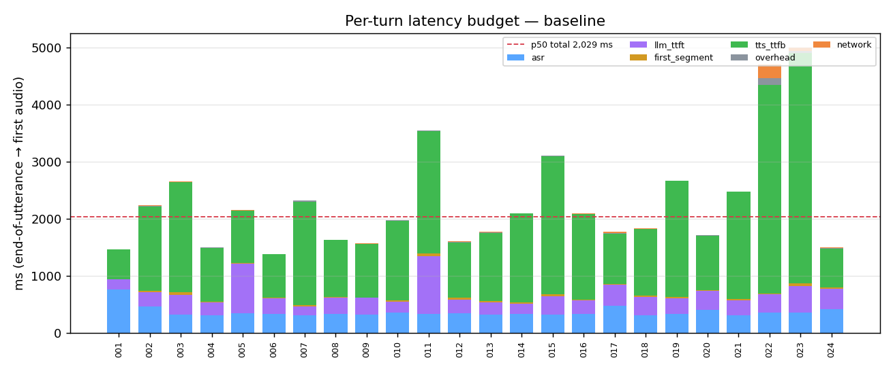
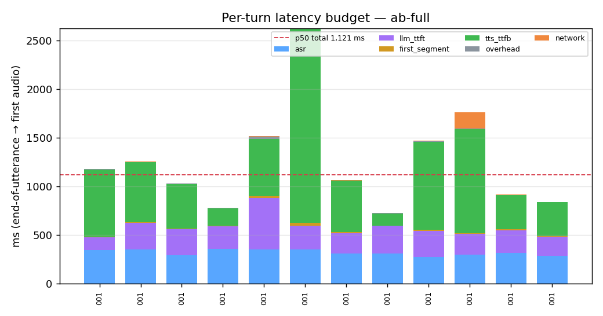
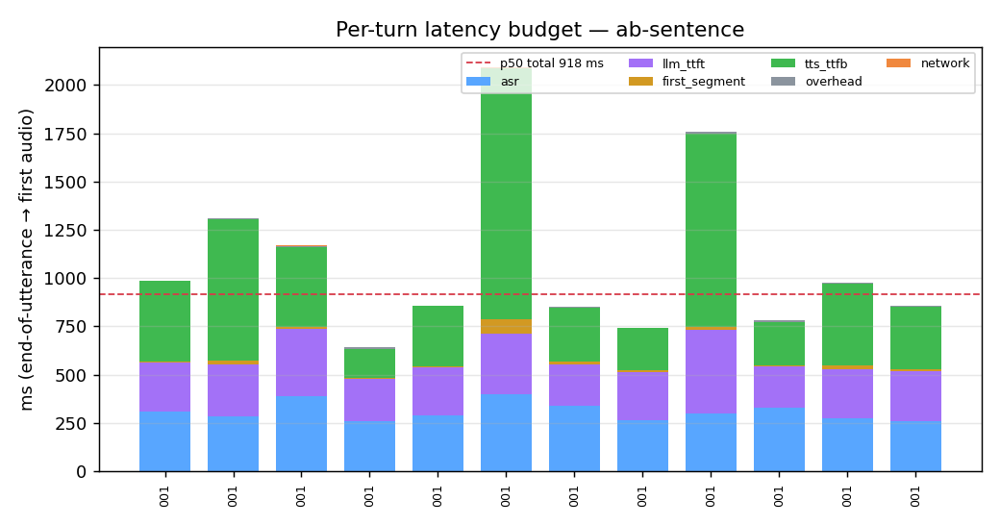
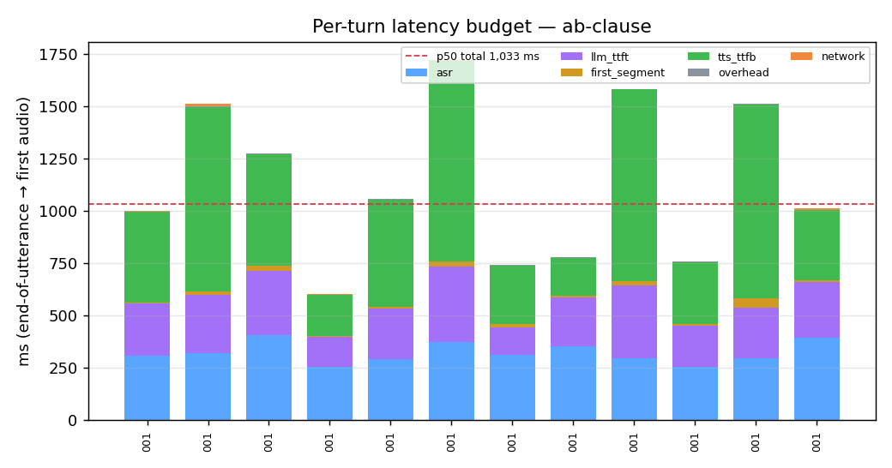
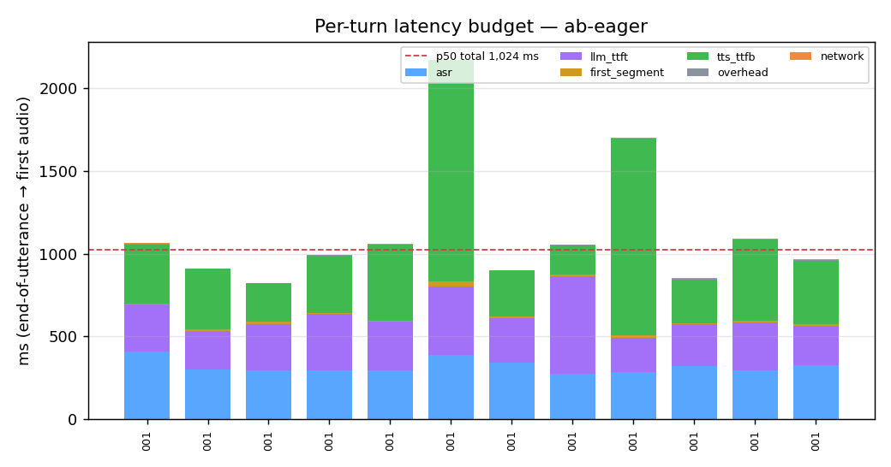
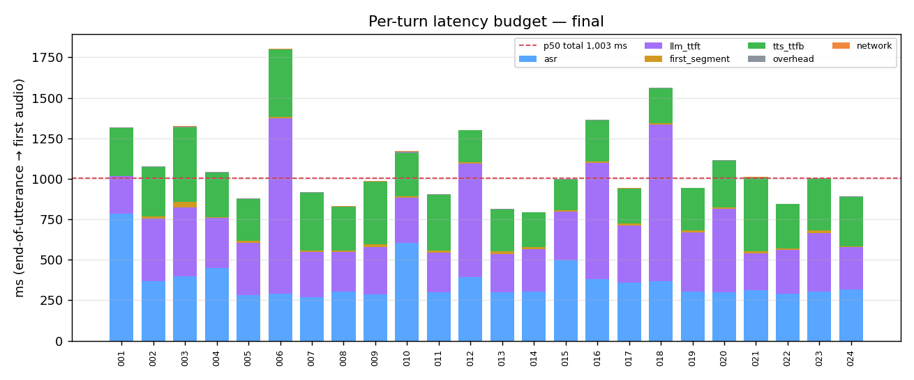
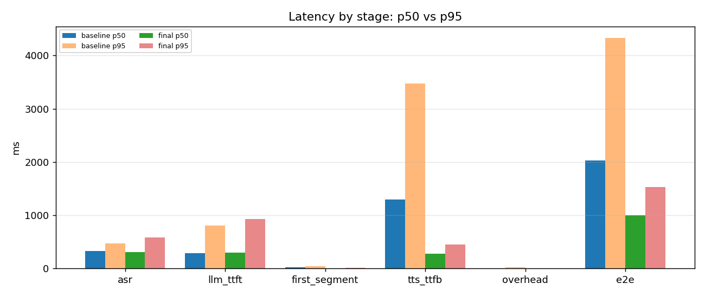
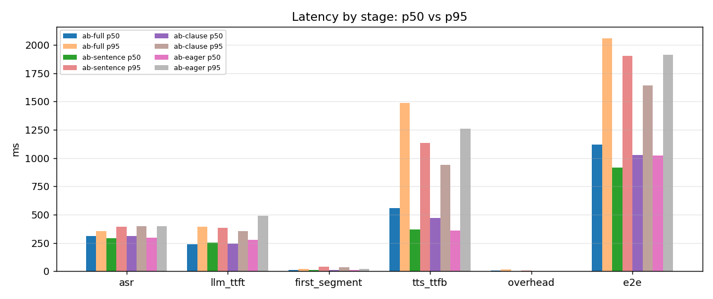

# Latency report

Generated by `scripts/report.py` from per-turn records. All values are measured, in milliseconds.
`e2e_ms` = server-side end-of-utterance → first `tts.audio` frame sent; `client_e2e_ms` adds the WebSocket hop and client handling as measured by the replay client.

### `baseline` — 24 turns (24 produced audio)

| stage | n | p50 (ms) | p95 (ms) | mean (ms) | share of e2e (p50-based) |
|---|---:|---:|---:|---:|---:|
| asr_ms | 24 | 329 | 474 | 363 | 16% |
| llm_ttft_ms | 24 | 285 | 813 | 332 | 14% |
| first_segment_ms | 24 | 21 | 42 | 24 | 1% |
| tts_ttfb_ms | 24 | 1,293 | 3,472 | 1,531 | 64% |
| overhead_ms | 24 | 5 | 29 | 12 | 0% |
| e2e_ms | 24 | 2,026 | 4,329 | 2,261 |  |
| network_ms | 24 | 4 | 64 | 18 |  |
| client_e2e_ms | 24 | 2,029 | 4,530 | 2,279 |  |
| llm_total_ms | 24 | 389 | 933 | 462 |  |
| tts_total_ms | 24 | 4,965 | 7,577 | 5,188 |  |
| turn_total_ms | 24 | 5,538 | 8,400 | 5,909 |  |

status: ok=24
providers: asr=groq:whisper-large-v3-turbo / llm=groq:openai/gpt-oss-20b / tts=piper:en_US-lessac-low ×24

### `ab-full` — 12 turns (12 produced audio)

| stage | n | p50 (ms) | p95 (ms) | mean (ms) | share of e2e (p50-based) |
|---|---:|---:|---:|---:|---:|
| asr_ms | 12 | 312 | 355 | 319 | 28% |
| llm_ttft_ms | 12 | 239 | 395 | 257 | 21% |
| first_segment_ms | 12 | 10 | 22 | 12 | 1% |
| tts_ttfb_ms | 12 | 560 | 1,490 | 655 | 50% |
| overhead_ms | 12 | 5 | 15 | 6 | 0% |
| e2e_ms | 12 | 1,121 | 2,060 | 1,247 |  |
| network_ms | 12 | 1 | 78 | 16 |  |
| client_e2e_ms | 12 | 1,121 | 2,150 | 1,262 |  |
| llm_total_ms | 12 | 301 | 713 | 367 |  |
| tts_total_ms | 12 | 2,370 | 3,472 | 2,251 |  |
| turn_total_ms | 12 | 2,928 | 4,010 | 2,841 |  |

status: ok=12
providers: asr=groq:whisper-large-v3-turbo / llm=groq:openai/gpt-oss-20b / tts=piper:en_US-lessac-low ×12

### `ab-sentence` — 12 turns (12 produced audio)

| stage | n | p50 (ms) | p95 (ms) | mean (ms) | share of e2e (p50-based) |
|---|---:|---:|---:|---:|---:|
| asr_ms | 12 | 292 | 394 | 308 | 32% |
| llm_ttft_ms | 12 | 252 | 386 | 272 | 28% |
| first_segment_ms | 12 | 12 | 42 | 17 | 1% |
| tts_ttfb_ms | 12 | 371 | 1,135 | 484 | 41% |
| overhead_ms | 12 | 2 | 9 | 3 | 0% |
| e2e_ms | 12 | 916 | 1,906 | 1,084 |  |
| network_ms | 12 | 1 | 5 | 2 |  |
| client_e2e_ms | 12 | 918 | 1,907 | 1,085 |  |
| llm_total_ms | 12 | 313 | 438 | 333 |  |
| tts_total_ms | 12 | 1,997 | 3,368 | 1,969 |  |
| turn_total_ms | 12 | 2,534 | 4,039 | 2,567 |  |

status: ok=12
providers: asr=groq:whisper-large-v3-turbo / llm=groq:openai/gpt-oss-20b / tts=piper:en_US-lessac-low ×12

### `ab-clause` — 12 turns (12 produced audio)

| stage | n | p50 (ms) | p95 (ms) | mean (ms) | share of e2e (p50-based) |
|---|---:|---:|---:|---:|---:|
| asr_ms | 12 | 311 | 399 | 321 | 30% |
| llm_ttft_ms | 12 | 244 | 355 | 249 | 24% |
| first_segment_ms | 12 | 14 | 35 | 16 | 1% |
| tts_ttfb_ms | 12 | 472 | 940 | 537 | 46% |
| overhead_ms | 12 | 1 | 5 | 2 | 0% |
| e2e_ms | 12 | 1,030 | 1,642 | 1,125 |  |
| network_ms | 12 | 2 | 8 | 3 |  |
| client_e2e_ms | 12 | 1,032 | 1,645 | 1,128 |  |
| llm_total_ms | 12 | 335 | 396 | 318 |  |
| tts_total_ms | 12 | 1,899 | 3,090 | 1,896 |  |
| turn_total_ms | 12 | 2,503 | 3,702 | 2,483 |  |

status: ok=12
providers: asr=groq:whisper-large-v3-turbo / llm=groq:openai/gpt-oss-20b / tts=piper:en_US-lessac-low ×12

### `ab-eager` — 12 turns (12 produced audio)

| stage | n | p50 (ms) | p95 (ms) | mean (ms) | share of e2e (p50-based) |
|---|---:|---:|---:|---:|---:|
| asr_ms | 12 | 299 | 397 | 318 | 29% |
| llm_ttft_ms | 12 | 280 | 493 | 307 | 27% |
| first_segment_ms | 12 | 10 | 24 | 12 | 1% |
| tts_ttfb_ms | 12 | 361 | 1,259 | 491 | 35% |
| overhead_ms | 12 | 1 | 4 | 2 | 0% |
| e2e_ms | 12 | 1,022 | 1,912 | 1,130 |  |
| network_ms | 12 | 2 | 6 | 3 |  |
| client_e2e_ms | 12 | 1,024 | 1,914 | 1,133 |  |
| llm_total_ms | 12 | 334 | 548 | 374 |  |
| tts_total_ms | 12 | 1,979 | 4,227 | 2,222 |  |
| turn_total_ms | 12 | 2,764 | 4,794 | 2,859 |  |

status: ok=12
providers: asr=groq:whisper-large-v3-turbo / llm=groq:openai/gpt-oss-20b / tts=piper:en_US-lessac-low ×12

### `final` — 24 turns (24 produced audio)

| stage | n | p50 (ms) | p95 (ms) | mean (ms) | share of e2e (p50-based) |
|---|---:|---:|---:|---:|---:|
| asr_ms | 24 | 310 | 589 | 366 | 31% |
| llm_ttft_ms | 24 | 305 | 927 | 401 | 30% |
| first_segment_ms | 24 | 10 | 16 | 11 | 1% |
| tts_ttfb_ms | 24 | 275 | 448 | 295 | 27% |
| overhead_ms | 24 | 2 | 6 | 2 | 0% |
| e2e_ms | 24 | 1,002 | 1,531 | 1,076 |  |
| network_ms | 24 | 2 | 5 | 2 |  |
| client_e2e_ms | 24 | 1,003 | 1,532 | 1,077 |  |
| llm_total_ms | 24 | 386 | 986 | 473 |  |
| tts_total_ms | 24 | 1,524 | 2,481 | 1,674 |  |
| turn_total_ms | 24 | 2,234 | 3,234 | 2,453 |  |

status: ok=24
providers: asr=groq:whisper-large-v3-turbo / llm=groq:openai/gpt-oss-20b / tts=piper:en_US-lessac-low ×24

## p50 vs p95 by stage

## Chunking A/B (interleaved, same utterances, fresh session per run)

| mode | n | e2e p50 | e2e p95 | TTS TTFB p50 | TTS TTFB p95 | median paired e2e saving vs `full` | wins vs `full` |
|---|---:|---:|---:|---:|---:|---:|---:|
| `full` | 12 | 1,121 | 2,060 | 560 | 1,490 | – | – |
| `sentence` | 12 | 916 | 1,906 | 371 | 1,135 | 60 | 6/12 |
| `clause` | 12 | 1,030 | 1,642 | 472 | 940 | 65 | 6/12 |
| `eager` | 12 | 1,022 | 1,912 | 361 | 1,259 | 141 | 7/12 |

